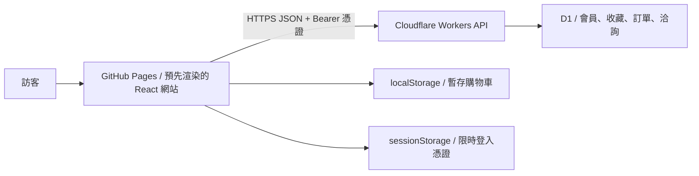

# GitHub Pages + Cloudflare Workers + D1

## D1 與 R2

D1 是以 SQLite 為基礎的雲端 SQL 資料庫，適合查詢會員與訂單等結構化資料。R2 是物件儲存，適合圖片、PDF、影片等檔案。本版採 D1；圖片隨 GitHub Pages 靜態資源發布，尚不需要 R2。

## 前台與發布

`scripts/build-pages.mjs` 先建置瀏覽器資源，再以 React 伺服器渲染產生每個路徑的 HTML。GitHub Pages 只託管靜態輸出，不執行 Worker 或 SQL。`sitePath()` 統一處理 GitHub 專案網站的 `/portfolio/` 前綴。

`config/public.json` 的 `apiUrl` 未設定時，公開版不發出 API 請求、不收集帳密，也不偽造收藏或訂單。開發模式才使用 loopback API。設定正式 HTTPS API 並重建後，才顯示完整會員表單。

## 登入與身分

- 帳號為 3–30 個英文字母、數字或底線；名稱 1–40 字元；密碼 12–128 字元。
- 伺服器以獨立隨機 salt 與 PBKDF2-SHA256（100,000 次，配合 Workers Web Crypto）保存密碼雜湊；不保存明文密碼。
- 成功登入取得 256-bit 隨機憑證；D1 僅保存憑證的 SHA-256 雜湊，12 小時過期。
- 憑證在目前分頁的 sessionStorage／記憶體，API 請求使用 Authorization header。瀏覽器不需允許第三方 Cookie。
- 登出會刪除伺服器 session。每個裝置重新登入可取回同帳號的雲端資料。
- 每個來源 IP 在 15 分鐘內最多 15 次帳號建立／登入嘗試。限流索引只保存分時段的 IP 雜湊與計數。
- 目前為作品體驗會員，未啟用 Email 驗證、密碼重設、MFA。正式收款或處理敏感資料前，應接入成熟身分服務並完成安全審查。

## D1 資料與授權

`cloudflare/migrations/0001_initial.sql` 包含 users、sessions、favorites、orders、inquiries、auth_limits。所有會員資料查詢以經驗證的 session 所屬 user_id 篩選，訪客傳入其他 user_id 不會改變授權對象。SQL 使用 prepare/bind，沒有拼接使用者值。

API 只允許明確列出的網站 Origin，支援帶 Authorization 的 CORS 預檢。寫入驗證 JSON 類型、大小及 Zod 結構。會員回應使用 `no-store`，前台不以 HTML 插入使用者文字。

## 訂單

前台只傳商品 ID、數量與冪等 UUID。Workers 根據 `lib/catalog.ts` 重新計價，每項數量 1–10、最多 12 列，重複商品會合併。滿 NT$3,000 免運，其餘運費 NT$120。前台傳入的價格不作依據。

`UNIQUE(user_id,idempotency_key)` 保證重試取得同一筆訂單。狀態僅 `demo_confirmed`，畫面明確標示未付款。尚未處理真實庫存、付款或物流。

正式金流應由 Workers 建立託管結帳，並驗證供應商 webhook 簽章後才變更付款狀態；不能相信前台的「成功」畫面。綠界、藍新或 Shopify 等正式商務服務需另外的商戶帳號與密鑰。

## 驗證

`scripts/check-hybrid-api.mjs` 在本機檢查匿名權限、CORS、註冊／登入、錯誤密碼、JSON、偏好持續儲存、收藏、數量驗證、價格重算、訂單重試、兩個帳號隔離及 session 失效。測試用帳密由程式隨機建立，不寫入原始碼或輸出。

參考：[Cloudflare D1](https://developers.cloudflare.com/d1/)、[Cloudflare R2](https://developers.cloudflare.com/r2/)、[GitHub Pages](https://docs.github.com/en/pages/getting-started-with-github-pages/what-is-github-pages)。
